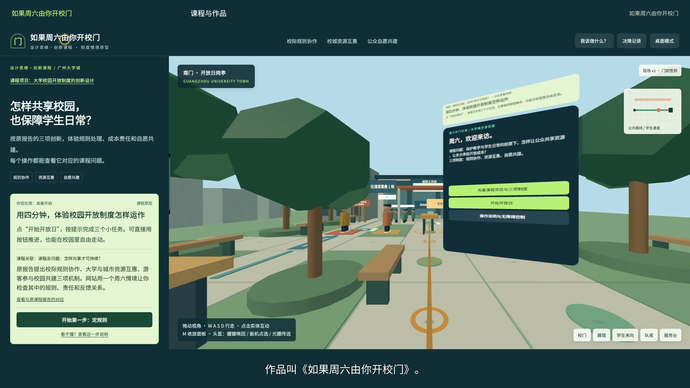

# 如果周六由你开校门

**[观看完整中文讲解视频（7分9秒）](https://github.com/pytenter/campus-visit/raw/refs/heads/main/video/output/saturday-campus-explained-zh.mp4)** · [中文字幕](video/output/saturday-campus-explained-zh.srt) · [讲解稿](video/output/讲解稿.md)

[](https://github.com/pytenter/campus-visit/blob/main/video/output/saturday-campus-explained-zh.mp4)

这是“设计思维·创新课程”期中汇报《大学校园开放制度的创新设计》的交互原型。课程问题是：保护教学与生活空间的前提下，怎样让不同能力的公众公平获得大学资源，并让开放成本由多方共同承担？

原报告三项创新分别是 **校际规则协作、大学与城市资源互惠、游客参与校园共建**。网站的课程入口逐项对应原报告第7至12、17、19页，可体验分级处理与本校复核、资源与成本责任核对、自愿反馈与下一轮生效。名额比较与挪桌是任务书增加的课堂情境，用于观察参与机会和通行冲突；它们并不替代前两项制度创新。全部制度情境与资源额度仍属拟议，程序运行不代表实地试点成效。

完整对应说明见 [docs/course-alignment.md](docs/course-alignment.md)。

使用 **Vite + TypeScript + A-Frame 1.7.1**。电脑、手机与兼容头显共用一个 A-Frame 场景、一个 renderer 和一份业务状态。校门、岗亭、展馆、连廊、树木、人物、纸桥展台及中文情境均由本项目原创。它是课程推演，不代表任何学校的真实建筑平面、开放政策或资源承诺。

## 本地启动与交付

环境：Node.js 22.12+；推荐 pnpm 11，也可使用 npm。仓库根目录即项目目录。

```bash
git clone https://github.com/pytenter/campus-visit.git
cd campus-visit
pnpm install --frozen-lockfile
pnpm dev
```

电脑访问 **[http://localhost:5173](http://localhost:5173)**。页面首屏即是校园与“开始开放日”。同一局域网手机可用终端显示的 Network 地址访问；HTTP 局域网访问用于触控体验，头显使用下方的可信 HTTPS。

如使用 npm：

```bash
cd campus-visit
npm install
npm run dev
```

构建、测试与生产预览：

```bash
pnpm test
pnpm build
pnpm preview --port 4173
# 另一个终端：浏览器验收需要已安装 Google Chrome
pnpm test:e2e
```

生产预览入口：[http://localhost:4173](http://localhost:4173)。对应的 npm 命令为 `npm test`、`npm run build`、`npm run preview -- --port 4173`。`dist/` 是可部署到静态服务器的完整产物，不要直接双击 `index.html` 使用 `file://` 打开。

依赖安装完成后，渲染库、模型、字体与课程逻辑均来自本地，不请求在线 CDN、照片或字体。断开外网后继续运行本地服务器即可用于课堂投影；手机与头显仍须连到承载服务器的局域网。本地进度与回执保存在当前浏览器的 localStorage，刷新会恢复，换浏览器、换端口或清除站点数据不会共享进度。

安装上述 Node 和包管理器即可构建运行，无需 Codex。

Git 仓库只保存源码，先生成 `dist/`，之后可用 Python 3 运行静态版本：

```bash
cd campus-visit
pnpm build
./start-demo.command
# 或 python3 -m http.server 5173 --bind 0.0.0.0 --directory dist
```

入口同为 [http://localhost:5173](http://localhost:5173)。`./start-demo.command 8000` 可换端口；macOS 也可双击此脚本。开发源码仍使用上方 Node/pnpm 流程。

## 不知道下一步怎么做时

左侧（手机下方）的浅绿色任务卡持续说明“你现在是 / 当前目标 / 下一步”，并给出可以直接点的下一步按钮。第一步 A、B 任意选，不替观众决定政策。重放时提示观察蓝衣学生 S01，结束后提示选桌；审批按学生代表、工作人员、发布、接待依次提示，由体验者轮流扮演，无需寻找真人。

右上角“我该做什么？”可查看当前步骤的目的和操作，再返回继续，保留身份与进度。头显里点世界面板上方的浅绿色任务条可查看同样说明。手机校园画面另保留简短的当前任务提示。

## 四分钟答辩顺序

| 时间 | 实际操作 | 给观众看的变化 |
| --- | --- | --- |
| 0:00–0:25 | 打开“课程项目与三项制度”，说明核心问题与原报告三项创新 | 观众先知道这是一份校园开放制度提案的可操作原型 |
| 0:25–1:00 | 创新一：比较初次误入与反复扰乱；看通知、提出申诉并更正 | 先帮助理解，再由本校复核；两校共享模板与匿名案例，不把轻微误入直接跨校联动 |
| 1:00–1:30 | 创新二：看活动容量、时段、成本承担和学生回馈，模拟学校、城市、社区核对 | 开放成本落实到责任方；三方模拟确认也不表示真实合作已落实 |
| 1:30–2:00 | 进入开放日，选 A、领卡、换 B 比较，再去展馆 | 同一身份、名单与顺序，规则变化导致4得4失8不变；用于讨论公平获取与数字门槛 |
| 2:00–2:45 | 重放门前布局，选桌移侧廊，再重放 | 同样三个人，学生通畅、访客多走2格；这是生成共建建议的观察证据 |
| 2:45–3:35 | 创新三：提交意见，两位角色确认，发布并接待下一位，沿正式路线到展馆 | 本地意见闭环真正改变下一轮的桌位与箭头；普通参观可跳过反馈 |
| 3:35–4:00 | 回看“本次推演与课程结论” | 区分课堂操作证据、拟议制度和真实待验证效果；原报告的访谈和80%理解门槛仍是研究计划 |

A/B 可以任一种开始。示范卡首次随机为 O09 或 W01，后续换规则不重抽。若要重做整场，末幕点“重置课堂演示”。普通访客也可在反馈幕直接跳过意见，继续接待；没有已发布修改时下一位仍遇见 v1。

## 三种交互

- **电脑**：拖动场景转头；WASD 或方向键行走；鼠标直接点击世界内中文面板、签到桌、地点光圈。M 键可收放浮动交互板，留出完整观察视野。左侧中文按钮有同等动作，支持 Tab 聚焦和 Enter 激活。
- **手机触控**：拖动转头，画面左下角方向按钮行走；轻点三维交互物体或中文等价按钮。横屏更适合投影展示，竖屏采用上下分区。
- **兼容头显**：页面检测安全上下文及 `immersive-vr` 支持，用户主动点击“进入头显”。左右手柄射线均可点世界内中文面板，扳机激活；点地面光圈定点传送；摇杆左右分段转向 30°，握键可收放交互板。退出后继续使用同一角色、规则、摆位与进度。设备不支持、检测失败或拒绝进入时继续桌面体验。

中文不是 A-Frame 默认字体的占位字符：`public/assets/NotoSansSC-Regular.otf` 含实际简体中文字形，页面等待本地字体加载，再绘制 Canvas 世界面板。规则、领卡、结果、摆位和审批都通过同一世界面板提供。

## 头显通过可信 HTTPS 访问

`localhost` 的电脑体验与“头显访问电脑局域网 IP”是两个地址。后者应使用设备认可的 HTTPS 证书。可将 `dist/` 放到已有可信 HTTPS 域名；如果课堂需要离线局域网，先在设备上完成本地 CA 信任配置。

开发证书可使用 [mkcert 官方说明](https://github.com/FiloSottile/mkcert)。例如电脑局域网 IP 为 `192.168.1.23`：

```bash
# 先安装 mkcert；macOS 可使用 brew install mkcert
mkcert -install
mkdir -p certs
mkcert -key-file certs/key.pem -cert-file certs/cert.pem localhost 127.0.0.1 ::1 192.168.1.23
HTTPS=1 pnpm dev
```

Windows PowerShell 的最后一步为：

```powershell
$env:HTTPS="1"
pnpm dev
```

头显与电脑连接同一局域网，用头显浏览器打开 `https://192.168.1.23:5173`，确认没有证书警告，再由用户点击进入头显。把示例 IP 换成自己的真实 IP，证书也须包含该地址。`vite.config.ts` 已支持读取 `certs/key.pem` 与 `certs/cert.pem`。

mkcert 在电脑安装的本地 CA 不会自动被头显信任。设备支持导入开发 CA 时，使用 `mkcert -CAROOT` 找到目录，只将 `rootCA.pem` 导入设备并按设备设置启用信任，不传输 CA 私钥。部分头显浏览器不接受这种证书链，应改用设备已信任的正式 HTTPS 域名/证书或设备官方开发连接方式。单纯跳过证书警告不等同于建立 WebXR 所需的安全上下文。[A-Frame 设备与浏览器说明](https://aframe.io/docs/1.7.0/introduction/vr-headsets-and-webxr-browsers.html)可用于核对目标浏览器；本次没有实体头显实测。

## 可复核的规则与空间数据

业务实现集中在 `src/domain.ts`，不依赖 DOM 或 XR：

- 名单固定为 O01–O12、W01–W04，各按编号排序，每人一席。`allocate()` 逐人生成结果与原因，`compare()` 计算得失，场景人物去向和结果卡读取同一分配结果。
- `LAYOUTS` 与 `GRID` 定义 9×7 格网。校门 `(1,4)`、展馆 `(7,4)`，学生路线 `(1,2)` 至 `(7,2)`；场景转换为 `x=(格x−4)×2.4`、`z=(格y−3)×2.4`。
- 门前桌 `(5,4)`，队列 `(5,3)/(5,2)`；侧廊桌 `(4,5)`，队列 `(3,5)/(2,5)`。所有访客路线横竖相邻，经过桌子至展馆。`metrics()` 从路线与队列交集计算 6/8 格、1/0 格重叠。这些数字是课程推演，不是实测校园步行距离。
- `preview` 只控制临时试摆。`published` 保存双审后的正式版本；`active` 是当前一轮访客采用的现场。`nextVisitor()` 只从正式版本读取，不能把尚未发布的试摆当作新现场。
- 纸卡与电子意见都生成本地回执。学生代表与工作人员分别复核；暂缓必须有原因。双审通过才能发布；每个决定都有影响者、结果和原因。恢复时检验回执、审批状态与发布版本证据，不兼容或损坏数据安全回到初始场景。

## 源码与素材替换

| 位置 | 内容与替换方法 |
| --- | --- |
| `src/scene.ts` | 原创校园、人物、纸桥与家具；在岗亭、展馆、连廊、树木和 `person()` 相关构造处替换模型，保留格网位置和交互 action |
| `public/assets/` | 放小组原创 `.glb`、贴图与实景对照照片；在 `scene.ts` 用本地 `gltf-model` / `a-image` 引用。保留轻量模型作为未加载时的默认校园 |
| `src/components.ts` | Canvas 中文面板、鼠标/触控行走、XR 控制器与分段转向 |
| `src/main.ts` | 三幕教学流程、桌面等价控件、世界面板、回执查询、服务台值班表和匿名案例文案 |
| `src/course.ts` | 原报告三项创新、页码、逐幕关联和本次证据复盘 |
| `src/institutions.ts` | 本校复核申诉与资源责任核对的课堂原型 |
| `src/domain.ts` | 名额、名单、路线、身份、审批、发布和持久化；改课程规则时先在此修改，再运行业务测试 |
| `src/style.css` | 电脑投影与手机布局；本地中文字体 `@font-face` |
| `tests/domain.test.ts` | 可确定性复现的分配、路径、版本隔离、双审和恢复验收 |

添加照片后建议只在相应站点新增“实景对照”面板，保持行走和主选择仍在 3D 场景完成。新增素材的作者、来源、许可与本地路径写入 [docs/references.md](docs/references.md)。当前不依赖小组照片，也没有取用参考校园项目的照片或全景。

## 实际参考与许可

实际阅读并核对许可的文件、固定提交、解决的问题与对应代码如下；完整记录见 [docs/references.md](docs/references.md)，许可原文见 [docs/third-party-licenses/](docs/third-party-licenses/)。

| 参考项目 / 文件 | 解决的问题 | 本项目对应 |
| --- | --- | --- |
| [A-Frame](https://github.com/aframevr/aframe)：`docs/core/scene.md`、camera/raycaster 文档、`src/components/cursor.js`、`laser-controls.js` | 一个 renderer 和相机组，鼠标与手柄点选同一对象 | `src/main.ts` 场景与 rig；`src/components.ts` 统一 action |
| [aframe-xr-boilerplate](https://github.com/AdaRoseCannon/aframe-xr-boilerplate)：`index.html`、`simple-navmesh-constraint.js` | 头部相机与 rig 分离，移动后约束可行走地面 | `src/main.ts` 相机组；`src/components.ts` 平坦格网公共道路约束，按当前 A-Frame 版本独立实现 |
| [webxr-samples](https://github.com/immersive-web/webxr-samples)：`input-selection.html`、`teleportation.html` | 控制器射线选择、传送与头部位置补偿、30°转向 | `src/components.ts` XR 输入；`src/main.ts` 地面光圈与传送 |
| [nutech-tour](https://github.com/AleenaTahir1/nutech-tour)：`src/components/TourView.js`、`TourView.tsx`、`src/data/locations.ts`、`src/types/index.ts` | 地点组织与导航热点 / 信息热点区分；实质地点表位于 `TourView.js` | `src/scene.ts` 的“前往展馆”与“限制区域说明” |
| [Choices](https://github.com/drhycheung/Choices)：`engine.js`、`scenarios/ai-hiring.json`、`docs/vibe-coding.md` | 确定性结果、历史记录与 why 因果复盘 | `src/domain.ts` 纯逻辑、日志；`src/main.ts` 决策记录；业务单测 |

五个参考项目在核对提交均为 MIT，已保留作者及许可；A-Frame 是实际安装依赖，其余参考用于独立实现。中文字体来自 Noto CJK，按 SIL OFL 1.1 随本地文件保留署名和完整许可，见 `public/assets/FONT-SOURCE.txt` 与 `NotoSansSC-OFL.txt`。

## 实际测试范围

业务单元测试已实际运行 **26/26 通过**：覆盖两种起始政策、两张身份、正反向规则比较、相邻格路线、6/8 与 1/0 指标、两种反馈渠道、暂缓原因、双审发布、预览隔离、下一访客正式现场、刷新恢复与损坏/矛盾数据容错。

桌面浏览器实际点选三维物体、手机触控模拟、XR 不可用回退及构建结果，以 [docs/test-report.md](docs/test-report.md) 的本次实测记录为准。模拟输入与浏览器自动化不能证明实体头显上的视觉舒适度或控制器兼容性；**本次没有实体头显实测**。头显课堂演示前，需在目标设备上走完同一条“岗亭选规则→领卡→展馆→挪桌→发布→下一访客”路径。

## 中文讲解视频

已录制完整桌面演示，约7分9秒，1920×1080，中文旁白与内嵌中文字幕。包含三项制度、规则比较、两次原速重放、移桌、暂缓与重新审核、发布、新版接待及课程复盘。

- [完整MP4](video/output/saturday-campus-explained-zh.mp4)
- [可编辑SRT字幕](video/output/saturday-campus-explained-zh.srt)
- [讲解稿](video/output/讲解稿.md)
- [章节时间点](video/output/chapters.txt)

旁白采用本机普通话语音合成。录制使用独立浏览器上下文，演示身份固定O09；不改变网站正式抽取逻辑或用户原有进度。手机片段为浏览器尺寸演示，实体头显未实测。重建方法见video/output/README.md。
